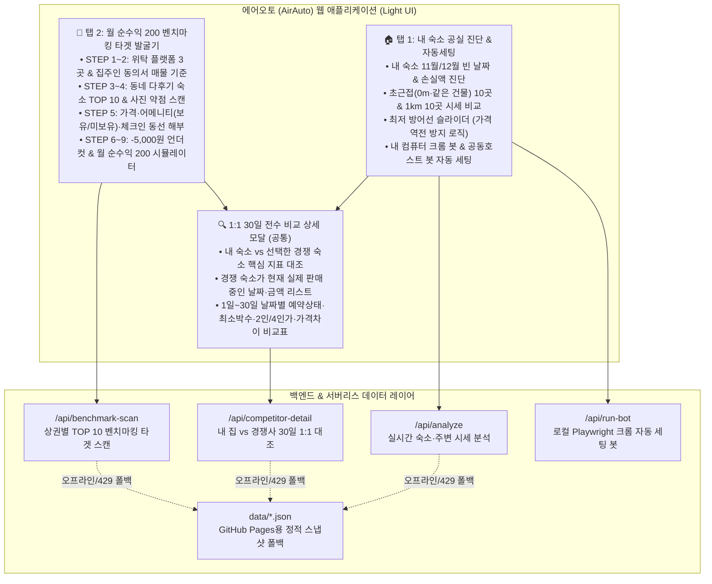

# 📋 [PRD v3.0 종합 완성본] 에어비앤비 AI 공실 자동세팅 & 월 순수익 200 벤치마킹 솔루션 (에어오토 AirAuto)

> [!IMPORTANT]
> **핵심 비즈니스 모델 및 프로덕트 총괄 요약 (v3.0 업데이트)**
> * **과금 모델:** **등록 숙소(Listing ID) 1개당 월 1,900원** (숙소 3개 운영 시 `₩1,900 × 3 = 월 ₩5,700`)
> * **탭 1 — 내 숙소 공실 진단 & 자동 세팅:** 에어비앤비 숙소 링크만 넣으면 5초 만에 **① 내 숙소 빈 날짜·공실 원인 진단**, **② 같은 건물/옆집(0m~136m) 초근접 숙소 10곳 & 반경 1km 경쟁 숙소 10곳 실시간 시세 비교**, **③ 내 집과의 30일 날짜별 1:1 판매가·최소숙박 비교표 모달**, **④ 최저 방어선 기반 1클릭 달력 자동 세팅**을 제공.
> * **탭 2 — 월 순수익 200만 원 벤치마킹 타겟 발굴기 (9단계 공식):** 위탁/신규 창업자 및 기존 호스트를 위해 상권 내 **슈퍼호스트·다후기 숙소 TOP 10**을 찾아내고, **후기는 많은데 사진·시설이 아쉬운 1순위 먹잇감**을 선별해 **어메니티 빈틈 + 체크인 동선 + `-₩5,000` 언더컷 요금 + 월 순수익 200만 원 달성 시뮬레이션**을 자동 산출.
> * **배포 환경:** 로컬 서버(`http://localhost:8765`) + GitHub Pages 서버리스 웹앱(`https://ttmacrash.github.io/airauto/`) 동시 지원 하이브리드 아키텍처.

---

## 1. 문제 정의 및 핵심 인사이트 (Problem & Discovery)

### 1.1 호스트들이 겪는 4대 핵심 의문과 페인 포인트
1. **"우리 건물·바로 옆집 숙소들은 대체 11월에 몇 박이나 찼고 얼마에 팔고 있을까?"**
   * 에어비앤비에서 특정 날짜(`11/04~11/06`, 2박)를 넣고 검색하면, **이미 예약이 꽉 찬 만실 숙소**나 **최소 숙박일수를 `3~4박`으로 걸어둔 숙소**는 검색 결과에서 아예 숨겨져 호스트가 존재조차 놓치게 됨.
   * 또한 에어비앤비 개인정보 보호 정책상 숙소 좌표에 `8m~136m`의 랜덤 오프셋(안심 반경 원)이 적용되어 같은 건물이라도 지도상 약간씩 흩어져 보임.
2. **"남의 집이 언제 얼마에 팔렸고, 최소 몇 박으로 묶여 있는지 어떻게 알 수 있나?"**
   * 에어비앤비 GraphQL 달력 API(`StaysPdpAtomicAvailabilityCalendarV2Query`)와 실시간 견적 API(`StaysPdpBookItQuery`)를 결합해, 날짜별 예약 마감 여부(`available: false`), 요일별 최소 숙박일수(`minNights`), 2인 기준 vs 4인 기준 1박 실결제가(청소비·수수료 포함 총액 ÷ 박수), 취소선 할인 배지(`originalPrice`) 유무를 100% 역추적.
3. **"내 숙소(HOUSE-TORY)는 왜 평점 5.0인데도 11월에 8박이 비어 있을까?"**
   * 같은 건물·옆집 경쟁자 분석 결과:
     * **단가 및 인원별 요금 괴리:** 옆집 1위 그룹(`[ANKAN]`, `새로 지은 2룸 건물`, `엘리하우스`)은 **2인 기본가를 `₩110,000~₩114,000`으로 낮춰 평일 커플을 싹쓸이**하고 3~4인일 때만 `₩133,000~₩134,000`을 받는 이원화 전략으로 **90~93% 가동률**을 달성한 반면, 내 숙소는 2인이든 4인이든 동일하게 `₩126,000~₩160,000`을 받아 평일 2인 검색에서 밀림.
     * **4가지 예약 전환 부스터 누락:** ① 취소선 할인 배지(`~~₩143,100~~ → ₩125,000`) 미적용, ② 즉시 예약(`canInstantBook`) 비활성화, ③ `11/29~12/03` 구간 최소 숙박 `2박` 제한, ④ 2인 평일 특가 미분리.
4. **"월 순수익 200만 원 나는 숙소를 처음부터 기획하거나 리뉴얼하려면 어디를 베껴야 하나?"**
   * 막연히 감으로 인테리어하고 가격을 정하는 것이 아니라, 검증된 **'9단계 에어비앤비 벤치마킹 공식'**을 데이터로 자동화할 필요가 있음.

---

## 2. 전체 시스템 아키텍처 및 2-Tab 메뉴 구조

---

## 3. [탭 1] 내 숙소 공실 진단 & 자동 세팅 상세 명세

### 3.1 초근접 이웃(0m·같은 건물·옆집) 10곳 전수 스캔 엔진 (`fetch_ultra_close_neighbors`)
* **작동 원리:** 날짜 조건(`checkin`/`checkout`)을 제거한 상태에서 반경 250m 고배율(`zoom=18`) 지도 스캔을 수행하여, **이미 100% 만실인 숙소**와 **최소 숙박이 3~4박으로 묶인 숙소**까지 빠짐없이 포착.
* **제공 데이터 (내 숙소 대비 가격 차이 즉시 표기):**
  * 11월 예약률(%) 및 예약 완료 일수 / 12월 예약률(%)
  * 평일·주말 최소 숙박일수 규칙 (`평일 1박 / 주말 2박` vs `3~4박 묶임`)
  * 2인 기준 평일 1박 실결제가 vs 4인 기준 1박 실결제가 (인원 추가금 역산)
  * **내 숙소 평균가(`₩143,275`) 대비 1박당 얼마 차이인지(`₩32,927 더 저렴` vs `₩42,725 더 비쌈`)** 한눈에 뱃지로 표시.

### 3.2 내 집 vs 경쟁 숙소 '30일 날짜별 1:1 상세 비교 모달' (`compare_competitor_detail`)
어떤 숙소든 **`[🔍 날짜별 판매가 & 내 집과 1:1 비교표 보기]`** 버튼을 클릭하면 모달이 열리며 아래 3단 데이터를 투명하게 공개합니다.
1. **상단 핵심 요약 대조 (내 숙소 vs 선택한 숙소):**
   * 11월 예약률 및 예약일수 (`내 숙소 73.3% / 22박` vs `경쟁 숙소 90.0% / 27박`)
   * 2인 기준 1박 평균 판매가 및 **내 집과의 정확한 금액 차이(`±₩00,000/박`)**
   * 4인 기준 1박 평균가 및 1인당 인원 추가 요금
2. **중단: 이 숙소가 현재 실제로 팔고 있는 빈 날짜 구간 & 실결제가 리스트:**
   * 경쟁 숙소의 열려 있는 날짜 구간별 `최소 박수`, `2인 1박 실결제가(취소선 원가 포함)`, `4인 1박 실결제가`, `내 집과의 가격 차이`, `즉시예약/할인배지 유무`를 표로 제시.
3. **하단: 11월 1일 ~ 30일 전수 1:1 일자별 비교표:**
   * 1일부터 30일까지 하루도 빠짐없이 **[날짜/요일] - [내 숙소 상태·최소박수·2인 요금] - [경쟁 숙소 상태·최소박수·2인/4인 요금] - [내 집 대비 가격 차이 & 승패 판정]**을 대조.
   * 예: *"내가 비어 있는 날(`⚪ 공실`) 저 집은 왜 예약이 찼는지(`🔴 예약완료`), 둘 다 비어 있는 날 누가 얼마 더 비싼지"*를 100% 납득할 수 있게 시각화.

### 3.3 가격 역전 방지 로직이 적용된 'AI 자동 세팅 시뮬레이터'
* **문제 해결 (Price Inversion Guard):** 기존에 현재 요금이 `₩126,000`인 날짜(`11/04~11/06`)에 기본 방어선 슬라이더가 `₩140,000`으로 높게 잡혀 있으면 `~~₩126,000~~ → ₩140,000`으로 오히려 가격이 오르는 모순이 발생함.
* **해결 알고리즘:**
  * 슬라이더 기본값을 최저 공실 요금보다 낮은 `₩105,000`으로 자동 세팅.
  * 만약 호스트가 슬라이더를 현재 요금(`curPrice`)보다 높게 올리더라도, `finalTarget >= curPrice`가 되지 않도록 **현재 요금 대비 최소 5% 이상 할인된 금액(`Math.round(curPrice * 0.93 / 1000) * 1000`)**으로 자동 캡핑하여, 언제나 정상적인 취소선 할인(`~~₩126,000~~ → ₩108,000`)만 생성되도록 보장.

### 3.4 듀얼 자동 실행 엔진 (내 컴퓨터 크롬 봇 + 클라우드 공동호스트 봇)
1. **내 컴퓨터 전용 크롬 자동 세팅 봇 (`bot_runner.js`):**
   * 웹 화면에서 **`[⚡ 지금 내 에어비앤비에 자동 세팅 실행하기]`** 클릭 시 로컬 서버(`POST /api/run-bot`)가 맥북의 실제 Chrome 브라우저(`chrome_bot_profile`)를 띄워 에어비앤비 멀티달력(`/multicalendar/{listing_id}`)에 접속하고, 비어 있는 날짜들을 선택해 계산된 할인 요금을 실제로 자동 타이핑.
2. **클라우드 공동호스트(Co-host) 봇 초대 (월 1,900원 정식 구독 모델):**
   * 비밀번호 공유 없이 `manager01@airauto.kr`을 공동호스트로 초대하면 매일 밤 무인 자동 세팅.

---

## 4. [탭 2] 월 순수익 200 벤치마킹 타겟 발굴기 (9단계 공식) 상세 명세

호스트님이 제시하신 **에어비앤비 경쟁력 확보 9단계 공식**을 두 번째 탭 메뉴(`🎯 2. 월 순수익 200 벤치마킹 타겟 발굴기`)에 그대로 제품화했습니다.

| 단계 | 벤치마킹 9단계 공식 | 에어오토(AirAuto)에서의 데이터 판단 및 구현 방식 |
| :--- | :--- | :--- |
| **1단계** | **위탁 공간 사이트 3개부터 깔고** | **① 에어비앤비**(외국인·단기) + **② 미스터멘션**(내국인·한달살기, 실제 옆집 `1573166415151924411`도 미스터멘션 공동호스트 운영 중) + **③ 위홈/리브애니웨어**(합법 내국인 공유숙박 특례) 3대 플랫폼 동시 세팅 가이드 제공 |
| **2단계** | **집주인 동의서 받을 매물부터 골라** | 전대차 동의서(전대동의서) 확보 및 외국인관광 도시민박업/위홈 특례 등록이 가능한 **역세권 도보 5분 이내 2룸 빌라/단독/다가구** 매물 체크리스트 및 보증금·월세 상한선(`월세+관리비 ≤ ₩950,000`) 제시 |
| **3단계** | **이 동네 슈퍼 호스트 10개 찾아** | 선택한 상권(새절역·망원·연남·성수·종로·이태원) 반경 1km 내에서 **후기 수가 가장 많은 상위 10개 슈퍼호스트/인기 숙소**를 후기 많은 순으로 자동 추출 |
| **4단계** | **후기 100개 넘는데 사진이 별로인 집 골라내** | **사진·시설 약점 점수(`photoWeaknessScore`) 자동 산출:** • 구형 ID(7~8자리 구축 숙소) • 세로형(폰카 비율) 사진 장수 및 어두운 형광등 사진 • 후기 90~130개인데 평점이 `4.95 미만`(예: `제이에스하우스` 후기 93개, ★4.89로 슈퍼호스트 탈락)인 **1순위 먹잇감** 자동 타겟팅 |
| **5단계** | **그 집 가격, 어메니티, 체크인 동선 다 분석해** | • **요금:** 2인 평일가 vs 4인 주말가 분리 구조 해부 • **어메니티 빈틈:** 타겟 숙소에 **없는 핵심 무기(`❌ 건조기 없음`, `❌ 엘리베이터 없음`, `❌ 무료 짐보관 없음`)**를 적발해 "우리가 넣으면 즉시 이기는 포인트"로 표시 • **체크인 동선:** 역 출구 도보 시간, 도어락/짐보관 안내 문구 요약 |
| **6단계** | **내 집은 5천 원 깎아** | 타겟 숙소의 2인 1박 판매가(`targetPrice2p`)에서 **정확히 `-₩5,000`을 깎은 내 숙소 공략 요금(`myUndercutPrice2p`)**을 자동 계산 |
| **7단계** | **한 달 둘러보면 예약 패턴이 보여** | 타겟 숙소의 30일 달력 블록을 분석해 **`주말 포함 2~3박 단기 회전형`**인지 **`외국인/가족 3~5박 중장기 연박형`**인지 예약 패턴과 월 가동일수를 판별 |
| **8단계** | **숙소 한 곳의 월 순수익 200이 그렇게 시작된다** | `-₩5,000` 언더컷 요금 × 타겟 숙소 가동일수(25~28박)로 **예상 월 총매출**을 구하고, 예상 월세·공과금·청소비(`₩1,150,000`)를 차감한 **예상 월 순수익(`+₩1,878,592 ~ +₩3,400,000`)**을 실시간 계산 |
| **9단계** | **그 다음부터는 사진 다시 찍어서 슈퍼호스트 달면 끝** | 오픈 첫 달 `-₩5,000` 언더컷으로 예약 15건·후기 15개를 빠르게 뺏어온 뒤, 전문 광각 촬영 사진으로 교체하고 요금을 정상화해 슈퍼호스트 배지를 획득하는 로드맵 제시 |

### 4.1 실제 발굴된 내 숙소 동네(은평구 새절역 일대) 벤치마킹 타겟 TOP 10 요약
1. **타겟 #1 (`32821023`, HAPI HOUSE 1):** 후기 **130개** (★5.0) | 구형 8자리 ID 구축, 이층침대·세로 사진 4장 | 타겟가 `₩99,000` → 공략가 `₩94,000`
2. **타겟 #2 (`8311905`, 제이에스하우스):** 후기 **93개** (★4.89) | **🎯 최우선 먹잇감!** 후기 93개나 되지만 형광등 폰카 사진·시설 노후화로 평점 4.89(슈퍼호스트 탈락), 건조기·짐보관 없음 | 타겟가 `₩113,792` → 공략가 `₩108,792` (**예상 월 순수익 `+₩1,878,592`**)
3. **타겟 #3 (`1630706163417305575`, 서울 가을여행):** 후기 **46개** (★5.0) | 썸네일 분할 컷 과다, 8인 대비 욕실 1개 | 타겟가 `₩163,603` → 공략가 `₩158,603` (**예상 월 순수익 `+₩2,815,075`**)
4. **타겟 #4 (`1573166415151924411`, 새로 지은 2룸 건물):** 후기 **39개** (★4.92) | 11월 예약률 90%이나 위치 평점(4.79) 낮음, 흰 벽지 기본 빌라 사진 | 타겟가 `₩110,348` → 공략가 `₩105,348` (**예상 월 순수익 `+₩1,994,396`**)
5. **타겟 #5 (`1627358926242051687`, 은은한 햇살의 시간):** 후기 **38개** (★4.97) | 내 숙소 바로 옆 8m, 11월 93%(28박) 마감, 고단가 배짱 영업 | 타겟가 `₩180,000` → 공략가 `₩175,000` (**예상 월 순수익 `+₩3,400,000`**)
6. **타겟 #6 (`1627302071757596638`, 엘리하우스):** 후기 **37개** (★4.97) | 제목 키워드 부재, 가정집 침구 사진인데도 83% 가동 | 타겟가 `₩110,565` → 공략가 `₩105,565` (**예상 월 순수익 `+₩2,000,255`**)
7. **타겟 #7 (`1644122951065940911`, [ANKAN]):** 후기 **35개** (★5.0) | 0m 초근접, 11월 93% 마감, 여름 키워드(`#시원한객실`) 방치 | 타겟가 `₩114,212` → 공략가 `₩109,212` (**예상 월 순수익 `+₩2,057,936`**)
8. **타겟 #8 (`926764362992858332`, [까사미갈루]):** 후기 **34개** (★4.97) | 역에서 919m 원거리, 고단가로 11월 12박 공실 | 타겟가 `₩185,000` → 공략가 `₩180,000` (**예상 월 순수익 `+₩2,990,000`**)
9. **타겟 #9 (`1612945891747979882`, 숲전망/공원 휴식):** 후기 **30개** (★4.97) | 최소 숙박을 `3~4박`으로 묶어두어 단기 수요 이탈(11월 12박 공실) | 타겟가 `₩186,000` → 공략가 `₩181,000` (**예상 월 순수익 `+₩3,194,000`**)
10. **타겟 #10 (`1607074495612377400`, 새절역 도보 2분 신축):** 후기 **26개** (★4.96) | 1룸형인데도 `₩104,400` 가성비로 11월 96.7%(29박) 마감 | 타겟가 `₩104,400` → 공략가 `₩99,400` (**예상 월 순수익 `+₩1,833,200`**)

---

## 5. 무료(비로그인) vs 과금(PRO 로그인) 차등 제어 및 인증 시스템 (Paywall & Auth)

무료 방문자의 호기심을 자극해 전환율을 극대화하면서도, **월 1,900원 과금 회원(PRO)에게만 핵심 데이터를 무제한 개방**하도록 4단계 페이월(Paywall)과 ID/PW 로그인 인증을 구축했습니다.

| 기능 구분 | 🎁 비로그인 무료 체험자 (Free Tier) | 👑 월 1,900원 과금 회원 (PRO Tier · 로그인 인증) |
| :--- | :--- | :--- |
| **숙소 URL 공실 조회 횟수** | **최초 1회 무료 조회 허용** (2회차 조회 또는 다른 월/다른 숙소 조회 시도 시 즉시 PRO 로그인 모달 팝업) | **무제한 실시간 조회** (모든 숙소·모든 월 무제한) |
| **내 숙소 기본 공실 진단** | 빈 날짜 구간 & 방치 시 예상 손실액(`₩1,146,200`) 공개 (결제 유도 훅) | 전체 공개 |
| **초근접(0m·옆집) & 1km 시세** | 상위 **2곳만 맛보기 공개**, **3위~10위는 블러(`blur`) + 🔒 PRO 잠금 오버레이** | **초근접 10곳 + 1km 10곳 전체 100% 공개** |
| **1:1 30일 날짜별 판매가 비교표** | **🔒 잠금** (`[날짜별 판매가 비교]` 클릭 시 로그인 모달 오픈 → 로그인 즉시 해당 모달 자동 열림) | **전체 경쟁 숙소 30일 1:1 비교표 무제한 열람** |
| **AI 자동 세팅 크롬 봇 실행** | **🔒 잠금** (시뮬레이터 미리보기만 가능, 실제 달력 변경 봇 실행 차단) | **⚡ 1클릭 크롬 자동 세팅 봇 무제한 실행** |
| **탭 2: 월 순수익 200 타겟 발굴기** | **타겟 #1만 맛보기 공개**, 핵심 먹잇감인 **타겟 #2~#10은 블러(`blur`) 잠금** | **TOP 10 전체 먹잇감 & -₩5,000 언더컷 무제한 공개** |

### 5.1 아이디/패스워드 노출 원천 차단 및 어드민(Admin) 전용 계정 발급 시스템
무료 방문자가 화면에서 아이디·패스워드를 보고 무단 로그인하거나 셀프 가입으로 우회하는 것을 막기 위해, **사용자 화면에서는 모든 계정 힌트와 우회 버튼을 완전히 제거**하고 **오직 마스터 어드민(호스트님)만 과금 회원의 ID/PW를 발급·정지·삭제**할 수 있도록 설계했습니다.

1. **일반 방문자 화면 (노출 제로):**
   * 로그인 모달에는 오직 아이디·비밀번호 입력창만 표시되며, 어떤 예시 아이디나 비밀번호도 화면 및 HTML 소스에 평문으로 노출되지 않습니다.
   * 미결제 사용자는 **[✨ 월 1,900원 구독 & ID/PW 발급 신청]** 탭에서 입금/결제 신청 안내만 볼 수 있으며, 어드민이 승인·발급하기 전에는 로그인할 수 없습니다.
2. **마스터 어드민(Master Admin) 로그인 시 전용 관리 버튼 활성화:**
   * 마스터 어드민 계정으로 로그인하면 상단 네비게이션 바에 일반 유저에게는 보이지 않는 보라색 **`[🛠️ 어드민: 회원 ID/PW 발급·관리]`** 버튼이 나타납니다.
3. **어드민 회원 발급·관리 대시보드 (`#adminModal` & `/api/admin/*`):**
   * **신규 회원 ID/PW 즉시 발급:** 고객용 아이디, 비밀번호(`🎲 자동생성` 지원), 고객명/숙소 메모, 구독 숙소 수(1개당 월 1,900원 자동 계산)를 입력해 **`[+ PRO 계정 즉시 발급하기]`** 클릭 시 서버(`users.json`)에 즉시 생성됩니다.
   * **카카오톡/문자 발급 안내문 1클릭 복사:** 발급된 회원 행의 **`[📋 카톡 안내문 복사]`** 버튼을 누르면 접속 주소와 발급된 ID/PW가 담긴 안내 메시지가 클립보드에 복사되어 고객에게 바로 전달할 수 있습니다.
   * **구독 일시정지 / 복구 / 영구 삭제:** 미납 또는 해지 시 **`[⏸️ 정지]`** 버튼 하나로 해당 계정의 로그인을 즉시 차단(`active: false`)하거나 **`[삭제]`**할 수 있습니다.

---

## 6. 파일 구성 및 배포 링크 (Repository & Files)

* **웹 배포 주소 (GitHub Pages):** `https://ttmacrash.github.io/airauto/`
* **GitHub 저장소:** `https://github.com/ttmacrash/airauto`
* **로컬 서버 주소:** `http://localhost:8765`
* **주요 소스 파일:**
  * 프론트엔드 웹앱 (탭 1 + 탭 2 + 무료/PRO 블러 페이월 + 로그인 모달): [index.html](file:///Users/jaerimjeong/.gemini/antigravity/scratch/airauto/index.html)
  * 백엔드 API 서버 (`/api/login`, `/api/register`, `/api/analyze`, `/api/competitor-detail`, `/api/benchmark-scan`): [server.py](file:///Users/jaerimjeong/.gemini/antigravity/scratch/airauto/server.py)
  * 로컬 크롬 자동 세팅 봇 (Playwright 기반 멀티달력 제어): [bot_runner.js](file:///Users/jaerimjeong/.gemini/antigravity/scratch/airauto/bot_runner.js)
  * 서버리스 정적 스냅샷 데이터: [analyze_2026_11.json](file:///Users/jaerimjeong/.gemini/antigravity/scratch/airauto/data/analyze_2026_11.json), [benchmark_saejeol.json](file:///Users/jaerimjeong/.gemini/antigravity/scratch/airauto/data/benchmark_saejeol.json) 및 17개 경쟁 숙소별 `comp_*_2026_11.json`
