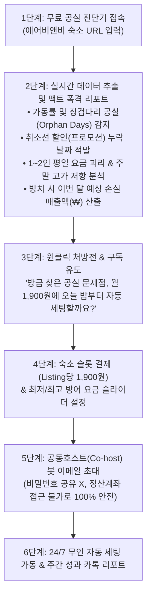

# 📋 [PRD v2.0] 에어비앤비 AI 자동 요금·공실 세팅 솔루션 (가칭: 에어오토 AirAuto)

> [!IMPORTANT]
> **핵심 비즈니스 모델 및 기술 방향 확정 (v2.0)**
> * **과금 기준:** **등록 숙소(Listing ID) 1개당 월 1,900원** (숙소 3개 등록 시 `1,900원 × 3 = 월 5,700원`)
> * **모객 킬러 훅(Viral Hook):** 에어비앤비 숙소 링크만 넣으면 5초 만에 **이번 달/다음 달 공실 원인(징검다리 공실, 할인 배지 누락, 인원별 요금 괴리, 주변 시세 비교)**을 실시간 진단해 주는 무료 분석기 제공
> * **완전 자동화 방식:** **공동호스트(Co-host) 봇 초대 방식** (호스트가 비밀번호 공유 없이 우리 AI 매니저 계정을 공동호스트로 초대하면, 클라우드 서버가 매일 밤 요금·프로모션·최소숙박일을 100% 무인 자동 수정)

---

## 1. 배경 및 문제 정의 (Problem Statement)

### 1.1 개인·부업 호스트의 페인 포인트 (Pain Points)
1. **비수기·평일 요금 책정의 어려움:** 내 숙소 주변 경쟁 숙소들이 이번 주 평일에 얼마를 받는지, 어디가 예약이 찼는지 매일 검색해 볼 시간이 없음.
2. **징검다리 공실(Orphan Days) 방치:** 주말 예약 사이에 낀 화·수 2박이나 일요일 1박 공실을 제때 가격 인하하거나 최소 숙박일수(`2박 → 1박`)를 풀지 못해 그대로 날림.
3. **할인 배지(취소선) 및 임박 노출 알고리즘 미활용:** 기본 요금만 내리면 게스트에게 '할인' 표시가 안 뜨는데, 날짜별로 일일이 맞춤 프로모션을 걸기 번거로움.
4. **기존 해외 솔루션의 높은 가격:** PriceLabs 등 해외 솔루션은 숙소당 월 27,000원 수준으로 소규모 호스트에게 부담스러움.

### 1.2 해결책 (Why 1,900원 / Listing?)
* **"무료로 내 숙소 공실 원인을 5초 만에 진단받고, 커피 한 잔 값도 안 되는 월 1,900원에 AI 공동호스트를 고용해 매일 밤 자동으로 세팅받는다."**
* **숙소(Listing ID) 단위 과금**을 통해 API/크롤링 서버 원가와 매출을 1:1로 연동(마진율 85~90%)하고, 다객실 호스트 유입 시 객단가(ARPU)를 자동 극대화.

---

## 2. 퍼널 설계: '무료 공실 진단기(Hook)' → '월 1,900원 자동 세팅 전환'

---

## 3. 핵심 자동 세팅 기능 (Core Features)

### 기능 1. 무료 실시간 공실 원인 진단 엔진 (Lead Magnet)
* **입력:** 에어비앤비 숙소 URL (`airbnb.co.kr/rooms/{listing_id}`)
* **실시간 추출 데이터:**
  * 숙소 기본 스펙 (최대 인원, 침실/침대 수, 평점, 세부 카테고리 평점, 게스트 선호 여부, 즉시 예약 여부)
  * 향후 30~60일 일자별 예약 가능 여부(`available`), 체크인 가능 여부, 최소 숙박일수(`minNights`)
  * 비어있는 공실 구간의 1박당 실제 요금, 원래 요금(`originalPrice` 취소선 유무), 인원별(1인 vs 만실) 요금 차이
* **자동 진단 알고리즘 (5대 공실 원인 판별):**
  1. **샌드위치/징검다리 공실 & 최소 숙박일수 잠김** (예: 4박 남았는데 `minNights: 2`로 묶여 단기 수요 차단)
  2. **임박 공실(D-14 이내) 취소선 할인 배지 누락** (`originalPrice == null`인 날짜 적발)
  3. **1~2인 평일 요금 차별화 부재** (1인 요금과 최대 인원 요금이 동일하여 평일 커플/솔로 수요 이탈)
  4. **즉시 예약(`canInstantBook`) 비활성화로 인한 임박 예약 이탈**
  5. **특정 주말/연박 구간 가격 저항 및 위치 평점 기반 가격 민감도 진단**

### 기능 2. 주변 경쟁 숙소(Comp-Set) 비교 및 평일 최적가 자동 세팅
* 반경 1~2km 내 동급 숙소(침실 수/인원수 기준) 10~15개의 실시간 가동률과 평일/주말 요금을 스캔하여, 비수기 평일에는 경쟁사 대비 5~10% 우위 가격으로 자동 세팅.

### 기능 3. 임박 공실 '맞춤 프로모션(취소선 할인)' 자동 발동
* 체크인 D-14, D-7, D-3까지 안 나간 공실에 에어비앤비 맞춤 프로모션을 자동 적용해 검색 결과 상단 노출 + 취소선 배지 획득.

### 기능 4. 징검다리 공실 '최소 숙박일수(2박→1박)' 자동 완화
* 예약 사이에 낀 1~2박 공실의 최소 숙박일을 자동으로 `1박`으로 풀고, 필요 시 1박 할증(+10%)을 자동 반영.

---

## 4. '공동호스트(Co-host) 봇 초대' 아키텍처

1. **연동 프로세스:**
   * 호스트가 결제 완료 후 안내받은 우리 봇 계정(예: `manager01@airauto.kr`)을 에어비앤비 **[공동호스트 초대 → 전체 권한]**으로 초대.
   * 우리 클라우드 서버의 봇이 초대 수락 메일을 감지해 즉시 자동 수락.
2. **보안 및 신뢰 포인트 (호스트 설득 문구):**
   * **비밀번호 요구 없음:** 내 계정 정보를 넘기지 않아 해킹·2단계 인증 번거로움 제로.
   * **대금 수령 계좌 접근 불가:** 에어비앤비 시스템상 공동호스트는 호스트의 정산 계좌나 세금 정보를 절대 볼 수도, 바꿀 수도 없음.
   * **1클릭 연결 해제:** 언제든 에어비앤비 앱에서 공동호스트를 삭제하면 즉시 제어 중단.
3. **계정 풀(Bot Pool) 확장 구조:**
   * 봇 계정 1개당 담당 숙소를 50~80개로 제한하여 에어비앤비 Rate Limit 방지 (`manager01`, `manager02`... 자동 할당).

---

## 5. 프로토타입(MVP) 구현 명세

* **프로젝트 경로:** `/Users/jaerimjeong/.gemini/antigravity/scratch/airauto`
* **기술 스택:** Python (FastAPI / 내장 HTTP 서버 + 실시간 에어비앤비 GraphQL 추출 엔진) + 모던 반응형 프론트엔드 (Tailwind CSS + 인터랙티브 UI)
* **프로토타입에 포함될 실제 작동 기능:**
  1. **실시간 에어비앤비 URL 분석기:** 실제 에어비앤비 링크(예: 호스트님의 `1714436404764677191` 또는 다른 숙소 링크)를 넣으면 실시간으로 에어비앤비 데이터를 긁어와 **11월/12월 달력 현황, 공실 구간, 일자별 요금, 5대 공실 원인 및 해결 처방전**을 화면에 시각화.
  2. **AI 자동 세팅 시뮬레이터:** 호스트가 '최저 방어 요금'을 설정하면, 비어있는 공실 날짜들이 **얼마로 자동 할인되고 최소 숙박일이 어떻게 풀리는지(Before → After)** 즉시 미리보기 제공.
  3. **숙소 단위(월 1,900원 × N개) 구독 계산기 & 공동호스트 봇 초대 모달:** 숙소 개수를 추가할 때마다 `1,900원 × N`이 계산되고, 공동호스트 봇 이메일을 복사해 초대하는 온보딩 플로우 완비.
